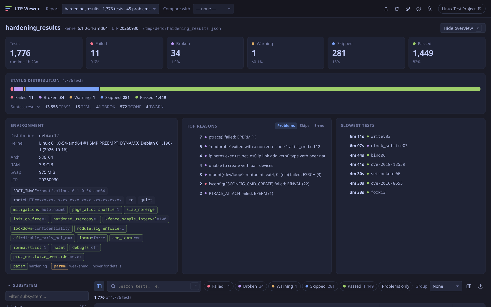
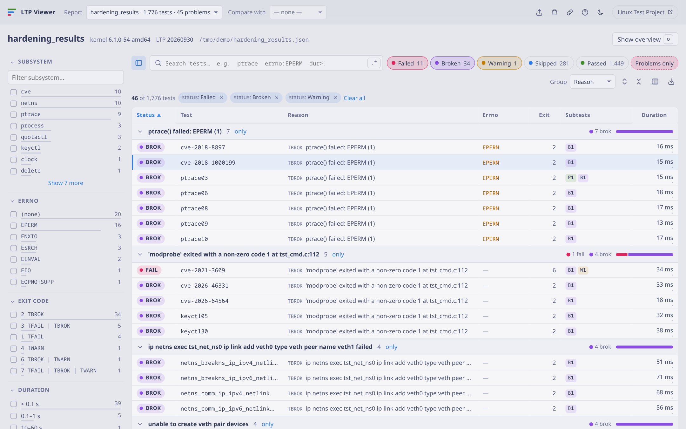
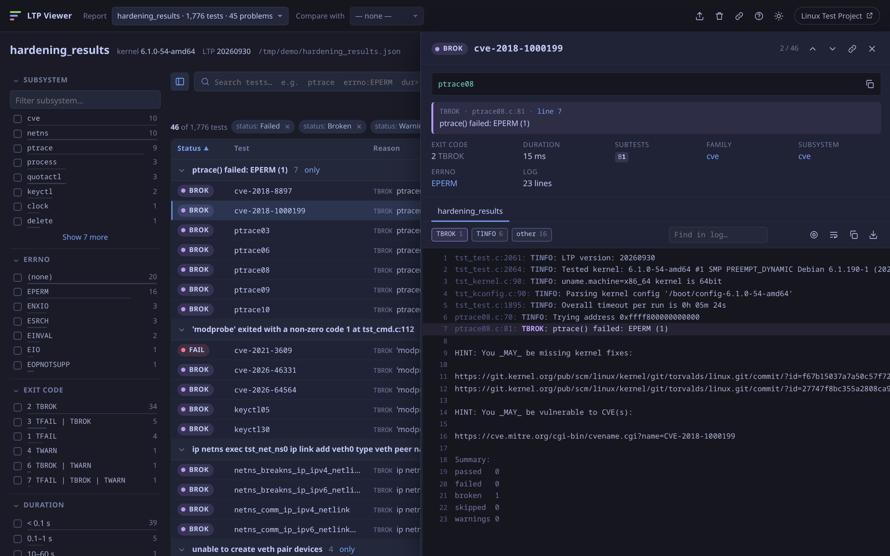

<div align="center">

# LTP Viewer

**A fast, minimalist web viewer for [Linux Test Project](https://github.com/linux-test-project/ltp) results produced by [kirk](https://github.com/linux-test-project/kirk).**

Filter, group, search and compare thousands of LTP test results, read the logs, and find out
*why* a test failed or was skipped.



</div>

> [!NOTE]
> This is an **unofficial** companion tool. All the actual testing is done by the
> [Linux Test Project](https://linux-test-project.readthedocs.io/) and its test executor
> [kirk](https://github.com/linux-test-project/kirk). Credit for the tests, their messages and
> the report format goes to the LTP developers. This project only makes the JSON report nicer to read.

## Why

`kirk --json-report results.json` writes one big JSON file with thousands of entries and multi-kilobyte logs. It's great for machines and painful for humans, especially when you need to answer questions like:

- *Which tests failed or broke after I hardened the kernel, and why?*
- *How many tests are skipped because of `lockdown`, a missing `CONFIG_*`, or a missing package?*
- *Did anything regress compared to the stock kernel?*

LTP Viewer turns the report into an interactive table with facets, grouping, a query language
and a log viewer, and it runs entirely offline.

## Features

- **Overview dashboard**: test counts by status, subtest totals (TPASS / TFAIL / TBROK / TCONF / TWARN),
  runtime, environment, and the top failure / skip reasons, errnos and slowest tests. Everything is clickable.
- **Kernel command line inspector**: every boot parameter is shown as a chip. Common hardening options
  (`lockdown`, `init_on_free`, `slab_nomerge`, `iommu.strict`, …) are highlighted and explained on hover,
  and weakening ones (`mitigations=off`, `nokaslr`, …) are flagged.
- **Status filters**: Failed / Broken / Warning / Skipped (TCONF) / Passed, plus a *Problems only* preset.
- **Facets** with live counts: subsystem, errno, exit code (decoded LTP bitmask), duration bucket,
  unsatisfied kernel config, test family and, when comparing, change vs baseline.
- **Grouping** by status, reason, errno, subsystem, family, exit code, duration or change, with
  per-group status bars, collapse/expand and one-click *only this group*.
- **Search with a small query language**: `ptrace errno:EPERM -cve dur>10`, `status:fail,brok`,
  `kconfig:SCHED`, `failed>0`, and full-text **search inside logs** with `log:hwpoison`. Regex mode included.
- **Reason extraction**: the first relevant `TFAIL` / `TBROK` / `TWARN` / `TCONF` message is pulled out
  of the log, with source location and errno. It understands the new C API, the shell API and the legacy
  API. Volatile bits (PIDs, addresses, tmp paths) are masked so identical failures group together.
  `Hint:` lines are skipped and kernel config aborts are replaced with the actual missing `CONFIG_*`.
- **Log viewer**: syntax-highlighted levels, per-level visibility toggles, find in log, jump to the
  first problem or to the reason line, wrap, copy and download.
- **Compare two runs** (e.g. stock vs hardened kernel): regressed / fixed / changed / new / missing,
  baseline status and duration delta columns, and side-by-side logs.
- **Choose your columns**: 20 columns (order, command line, family, kernel config, individual subtest
  counters, log size, Δ time, …) and three row densities.
- **Shareable views**: the entire view state (report, filters, grouping, sorting, opened test) lives in
  the URL, so you can copy a link or bookmark it.
- **Export**: CSV / JSON of the visible rows, copy as a Markdown table or as a plain list of test names
  (handy for skip files), or a **single self-contained HTML file** that works without a server.
- **Keyboard driven**: `/` search, `j`/`k` navigate, `Enter` open, `1`–`5` toggle statuses,
  `p` problems only, `g` cycle grouping, `t` theme, `?` help.
- **Zero frontend dependencies**: no CDNs and no build step, so it works on air-gapped test machines.

| Problems grouped by reason (light theme) | Test details and log |
|---|---|
|  |  |

## Quick start

Requires Python 3.9+.

```sh
git clone https://github.com/Qurclinc/ltp-viewer.git
cd ltp-viewer
python -m venv .venv && . .venv/bin/activate
pip install -e .

ltp-viewer results.json            # then open http://localhost:8080
```

No install needed if you prefer not to: `pip install flask && python -m ltpviewer results.json`.

### Producing a report

```sh
# inside your LTP installation, e.g. /opt/ltp
kirk --run-suite syscalls --json-report results.json
```

See the [kirk documentation](https://github.com/linux-test-project/kirk) for all options.

## Usage

```text
ltp-viewer [serve] [FILE|DIR ...] [-H HOST] [-p PORT] [-o] [--no-upload] [--debug]
ltp-viewer export FILE|DIR ... [-b BASELINE] [-o OUTPUT.html]
```

| Command | What it does |
|---|---|
| `ltp-viewer results.json` | Serve the UI on `127.0.0.1:8080` with one report loaded |
| `ltp-viewer reports/` | Load every `*.json` in a directory |
| `ltp-viewer stock.json hardened.json -o` | Load two reports and open the browser; pick one in *Compare with* |
| `ltp-viewer -H 0.0.0.0 -p 9000 --no-upload results.json` | Listen on all interfaces, disable browser uploads |
| `ltp-viewer export hardened.json -b stock.json -o report.html` | Write one offline HTML file with both reports and the comparison preselected |

You can also drag and drop JSON files onto the page (unless `--no-upload` is set). Reports are held
in memory only and never written to disk.

### Query language

Words are AND-ed and matched against name, command line, family and reason. A leading `-` negates a term, and
`"quotes"` group a phrase.

| Term | Meaning |
|---|---|
| `status:fail` | `fail`, `brok`, `warn`, `conf`/`skip`, `pass`; comma-separated values allowed; `status:problems` |
| `name:` `family:` `sub:` `cmd:` `reason:` | Field contains the text |
| `errno:EPERM` | Errno found in the reason (`errno:none` for none) |
| `kconfig:RT_GROUP` | An unsatisfied kernel config constraint contains the text |
| `dur>10` `dur<0.5` | Duration in seconds |
| `exit:32` `failed>0` `skipped>=2` | Exit code and subtest counters (`passed`, `failed`, `broken`, `skipped`, `warnings`) |
| `change:regressed` | When comparing: `regressed`, `fixed`, `changed`, `new`, `missing`, `same` |
| `log:"text"` | Full-text search inside test logs |

Toggle `.*` next to the search box to treat plain words and `log:` terms as regular expressions.

### How comparison works

Tests are matched by name plus occurrence index, since the same test can run several times in one report
(for example when it's listed in several runtest files). A test is:

- **regressed**: it is failed, broken or has warnings now, and it was passed or skipped in the baseline
- **fixed**: the reverse
- **changed**: any other status change (e.g. passed → skipped)
- **new** / **missing**: present in only one of the reports

## Notes on the data

- The status values come straight from kirk: `pass`, `fail`, `brok` (TBROK), `conf` (TCONF, shown as
  *Skipped*) and `warn`.
- *Subsystem* and *family* are heuristics derived from test names (`fcntl17_64` → family `fcntl`,
  subsystem `fcntl`; `cve-2017-1000405` → `cve`), because kirk's JSON doesn't record which runtest
  file a test came from.
- *Subtest results* in the overview are kirk's `stats`, which count individual `TPASS`/`TFAIL`/…
  results, not tests.
- Exit codes are decoded with LTP's bitmask: `1` TFAIL, `2` TBROK, `4` TWARN, `16` TINFO, `32` TCONF.

## Project layout

```text
ltpviewer/
  report.py     kirk JSON parsing and normalisation (reasons, errno, kconfig, families)
  store.py      in-memory report registry
  app.py        Flask app and JSON API
  export.py     self-contained HTML export
  cli.py        command line interface
  templates/    single HTML page
  static/       app.js / app.css (vanilla, no build step)
tests/          a few parser sanity checks (pytest)
```

### JSON API

| Endpoint | Description |
|---|---|
| `GET /api/reports` | Loaded reports with summary counts |
| `GET /api/reports/<id>` | Normalised test list (without logs), stats, environment |
| `GET /api/reports/<id>/tests/<idx>/log` | Raw log of one test (`?download=1` for a file) |
| `GET /api/reports/<id>/search?q=…&regex=1` | Indexes of tests whose log matches |
| `POST /api/reports` | Upload one or more reports (`multipart/form-data`, field `file`) |
| `DELETE /api/reports/<id>` | Unload a report |
| `GET /export/<id>.html?b=<baseline>` | Download a self-contained HTML file |

## Security

The server is meant for local use. It binds to `127.0.0.1` by default, has no authentication, and
uses Flask's development server. If you expose it on a network, put it behind a reverse proxy with
authentication and consider `--no-upload`. Alternatively, share a static `export` file.

## Acknowledgements

- [Linux Test Project](https://github.com/linux-test-project/ltp): the test suite whose results this tool displays.
- [kirk](https://github.com/linux-test-project/kirk): the LTP test executor that produces the JSON reports.
- [Tokyo Night](https://github.com/folke/tokyonight.nvim): the color palette behind both themes.

LTP Viewer isn't affiliated with or endorsed by the Linux Test Project.

## License

[MIT](LICENSE)
